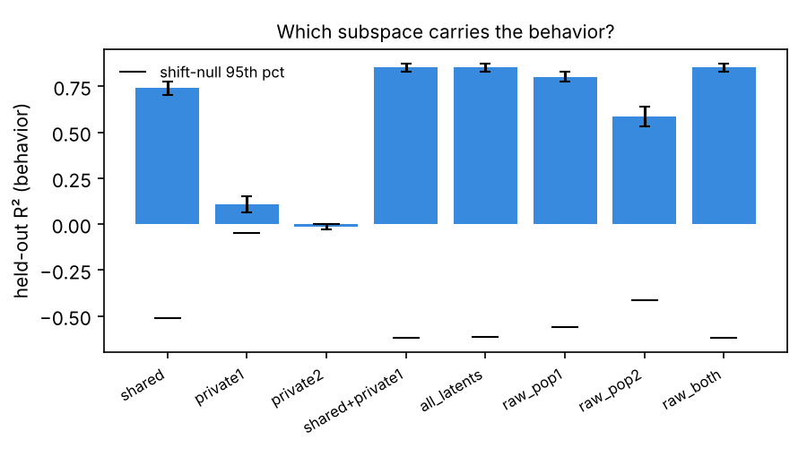
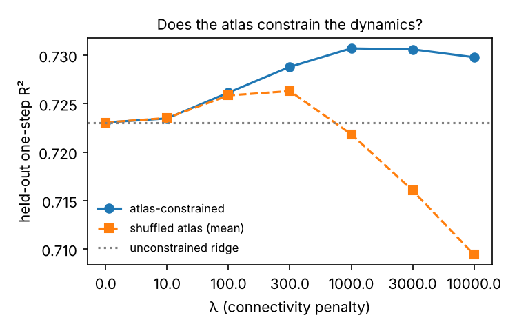

# allen-circuit-dynamics

Two questions about simultaneously recorded neural populations, asked of
Allen Institute open Neuropixels data, with a pipeline that runs end-to-end on
synthetic data in under a minute.

1. **Shared vs. private.** When two populations are recorded at the same time,
   how much of each one's activity is shared with the other, how much is
   private, and which part encodes a continuously measured behavior?
2. **Does wiring constrain dynamics?** When several areas are recorded together,
   does the anatomical projection structure between them predict the
   inter-area coupling of a linear dynamical model fit to the activity?

Status: pipeline complete and tested on synthetic data, and run once on a real
session (Visual Coding Neuropixels 715093703: VISrl, VISp, VISpm, VISl, VISam;
50 ms bins inside `natural_movie_one`; 12,009 bins). Results below are from
that single session and should be read as a first pass, not a study.

## Experiment 1 — shared / private factor analysis

Model: factor analysis on the concatenated vector `[x1, x2]` with a
block-sparse loading matrix, fit by EM with the zero pattern enforced at every
M-step.

```
x1 = W1 z + V1 u1 + mu1 + e1        z  : shared latents (d_shared)
x2 = W2 z + V2 u2 + mu2 + e2        u1 : private to population 1 (d_private)
                                    u2 : private to population 2 (d_private)
```

It is the static special case of probabilistic CCA with explicit private
subspaces (Bach & Jordan 2005) and of DLAG without time delays
(Gokcen et al. 2022). The experiment:

- selects `d_shared` and `d_private` by **held-out log-likelihood** under
  block-grouped cross-validation (contiguous time stays together),
- reports the **variance partition** (shared / private / noise) per population,
- benchmarks cross-population prediction (E[x2 | x1]) against
  **reduced-rank regression** at each rank (Semedo et al. 2019) and CCA,
- **decodes the behavior** from each subspace (shared, private-1, private-2,
  raw populations) with ridge regression under grouped CV, against a
  circular-shift null that preserves the behavior's autocorrelation.

On the synthetic demo (planted: 3 shared, 2 private per population, behavior a
readout of the shared factors plus population-1's private factors) the shared
subspace carries the behavior (R² ≈ 0.74), population-2's private subspace does
not (≈ 0), and the RRR curve flattens by rank 3. At the demo's firing rates the
linear-Gaussian model selects more dimensions than were planted (6 shared,
4 private) because Poisson counts put nonlinear structure into extra linear
directions; in the lower-gain regime the test suite uses, held-out likelihood
selects the planted 3 exactly. See Limits.



**Real session 715093703, VISrl (76 units) ↔ VISp (60 units).** Held-out
likelihood selects 6 shared and 4 private dimensions. Variance is mostly
noise at 50 ms (VISrl: 9% shared / 5% private / 86% noise; VISp: 16 / 10 /
75). The shared subspace decodes running speed (R² 0.27 ± 0.04 across folds;
circular-shift null p95 −0.11) and neither private subspace does (−0.04,
−0.07). All latents together reach 0.32 and the raw populations 0.41, so the
10-dimensional model keeps most, not all, of the behavior-relevant signal.
Cross-area prediction is near zero: E[VISp | VISrl] has R² −0.05 under the
factor model and reduced-rank regression tops out at 0.04 by rank 6. Read
together: at this bin size the "shared" factors look like a slow signal common
to both areas (locomotion / arousal), not fast inter-area communication. That
is the expected place for a static model to land and the reason DLAG-style
delays are the next comparison.

## Experiment 2 — connectivity-constrained linear dynamics

Per-area population latents are stacked into `S` and fit with a one-step
linear model `S[t+1] = S[t] A + b`. The atlas enters as a penalty on each
area-to-area block of `A` proportional to how *weak* that projection is:

```
penalty(A) = λ · Σ_{a,b} (1 − conn[a,b]) · ‖A_block(a,b)‖²
```

The test is held-out one-step prediction of the atlas-constrained model vs. an
unconstrained ridge model vs. models fit with a **shuffled** connectivity
matrix at the same λ. If the atlas carries information about the dynamics the
true-atlas curve should separate from the shuffled curve as λ grows; if it
doesn't, that's the finding. On the synthetic demo (six areas, eight latents
each, 1 200 bins, a planted sparse projection matrix) the two curves separate
at large λ and the fitted block norms correlate with the planted connectivity.



**Real session 715093703, five visual areas.** The unconstrained one-step
model explains R² 0.41 of the next bin's latents. The atlas prior does not
help: at every λ from 0.01 to 10 the atlas-constrained and shuffled-atlas
models agree to three decimals (Δ ≤ +0.001), and both lose accuracy once λ
exceeds about 1 (0.41 → 0.38 at λ = 10). So on this session the projection-
density matrix carries no information the one-step predictor can use beyond
what any equally sparse prior would. One suggestive signal: with no prior at
all, the fitted off-diagonal coupling-block norms correlate with projection
density (r = 0.54 over 20 blocks; the permutation p-value is computed by
`metrics.json` and should be quoted from there, not from this sentence). That
correlation is descriptive and comes from a single session and a single bin
size.

The first real run exposed a scaling bug — the penalty was in absolute units
and was swamped by a 10× longer recording — which is why λ is now
dimensionless (see `models/coupling.py`). The synthetic demo's curve is
unchanged under the fix.

## Run it

```bash
uv venv && source .venv/bin/activate
uv pip install -e ".[dev]"
acd demo --out outputs/demo_local  # both experiments, synthetic, ~30 s (outputs/demo/ is the committed run)
pytest
```

Real data (Visual Coding Neuropixels, public S3 bucket, no credentials):

```bash
uv venv --python 3.10 .venv-allen && uv pip install --python .venv-allen/bin/python -e ".[allen]"   # allensdk pins old scipy/pandas
.venv-allen/bin/acd fetch --session 715093703 --out data/ecephys    # areas chosen from the session (top VIS* by QC-passing units)
SESSION=715093703 bash scripts/run_experiments.sh                    # connectivity matrix + both experiments
```

`scripts/blade_bootstrap.sh --fetch` does all of the above on a fresh WSL box,
including a parallel ranged download of the 2.7 GB NWB from Allen's public S3
bucket (`scripts/pdl.sh`; allensdk's own download times out on slow links).

## What the loader does to the data

- Unit QC: `isi_violations < 0.5`, `amplitude_cutoff < 0.1`, `presence_ratio > 0.9`.
- Bins spikes at 50 ms inside the chosen stimulus epoch only (default
  `natural_movie_one`); a bin never straddles two presentation windows.
- Behavior = mean running speed per bin; bins with no speed samples are
  dropped and counted in the metadata.
- Units under 0.5 Hz are dropped and counted. Counts are square-root
  transformed, then z-scored with training-fold statistics inside every
  cross-validation loop.
- Twelve contiguous blocks define the CV groups.

Every `metrics.json` carries a provenance block: package version, git SHA,
library versions, config hash, and the dataset's own metadata.

## Layout

```
src/allen_circuit_dynamics/
  dataset.py          PopulationDataset — the one container every stage uses
  synth.py            planted-structure generators (both experiments)
  preprocess.py       unit filter, sqrt, fold-safe scaling
  models/shared_private.py   block-sparse FA by EM
  models/baselines.py        RRR, CCA, per-population FA
  models/coupling.py         connectivity-penalised linear dynamics + shuffle control
  decode.py           grouped-CV ridge decoding with a circular-shift null
  experiments.py      the two experiments as pure functions → metrics dict
  report.py           one figure per question
  allen_data.py       AllenSDK loader (lazy import) + atlas projection matrix
  cli.py              acd demo | fetch | latent | coupling
tests/                14 tests, ~30 s, synthetic only
scripts/blade_bootstrap.sh
```

## Limits, stated up front

- The shared/private model is linear-Gaussian and static. On Poisson-like
  counts it needs more dimensions than the generative truth to absorb the
  nonlinearity; held-out likelihood, not the planted number, is the criterion.
- Experiment 2's "areas" are PCA latents, not cell types, and the atlas prior
  is projection *density*, which says nothing about sign or cell-type
  specificity. The experiment can only say whether that coarse structure
  predicts coupling — not why.
- Running speed is a behavioral proxy available in the open dataset; it is not
  a measured motor output. The code accepts any continuous signal on the same
  bins.
- One session, one bin size, one stimulus epoch. Nothing above should be
  generalised until it holds across sessions and at 10–25 ms bins.
- The decoded behavior is running speed; a slow common signal that tracks it
  will show up as "shared" under a static model whether or not the areas
  communicate. Time-delayed shared latents (DLAG) are the test that separates
  the two.

## References

- Bach & Jordan (2005). A probabilistic interpretation of canonical correlation analysis.
- Semedo, Zandvakili, Machens, Yu & Kohn (2019). Cortical areas interact through a communication subspace. *Neuron*.
- Gokcen, Jasper, Semedo, Zandvakili, Kohn, Machens & Yu (2022). Disentangling the flow of signals between populations of neurons. *Nature Computational Science*.
- Siegle et al. (2021). Survey of spiking in the mouse visual system reveals functional hierarchy. *Nature*. (Visual Coding Neuropixels dataset)
- Oh et al. (2014). A mesoscale connectome of the mouse brain. *Nature*. (Mouse Connectivity Atlas)
