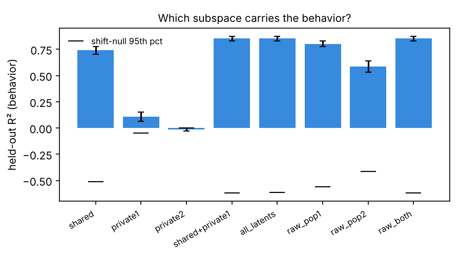
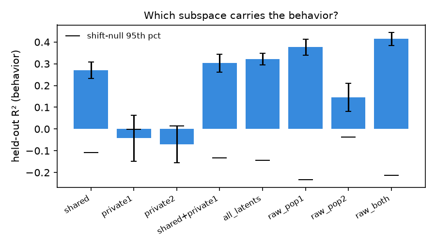
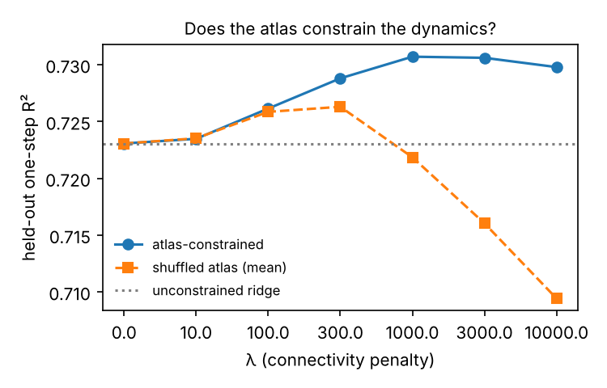
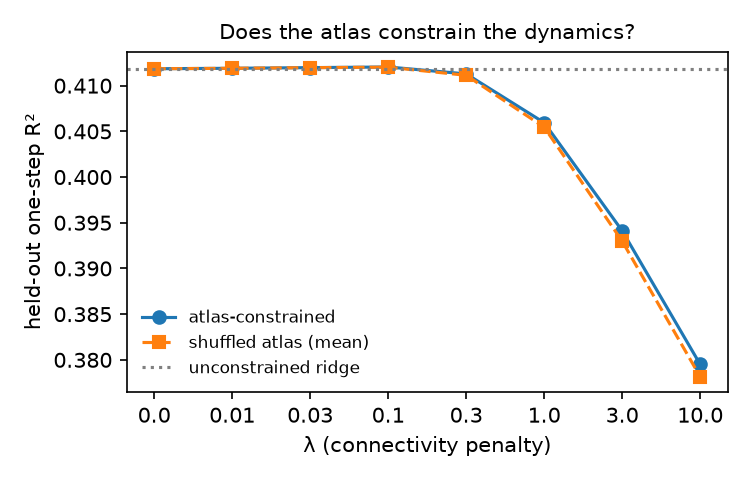
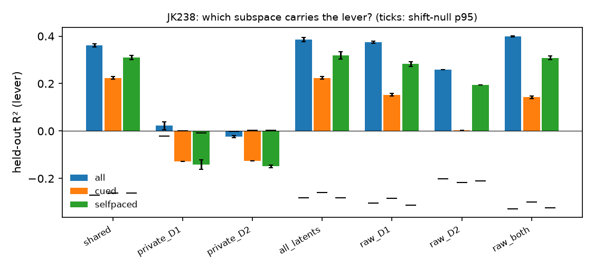
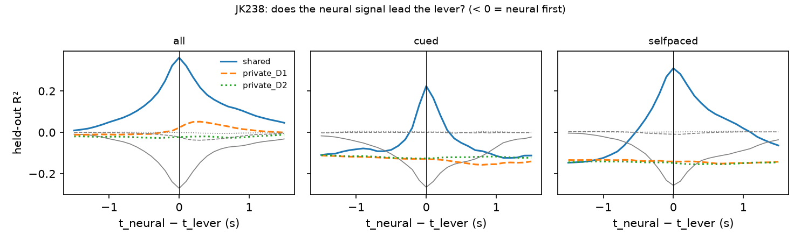
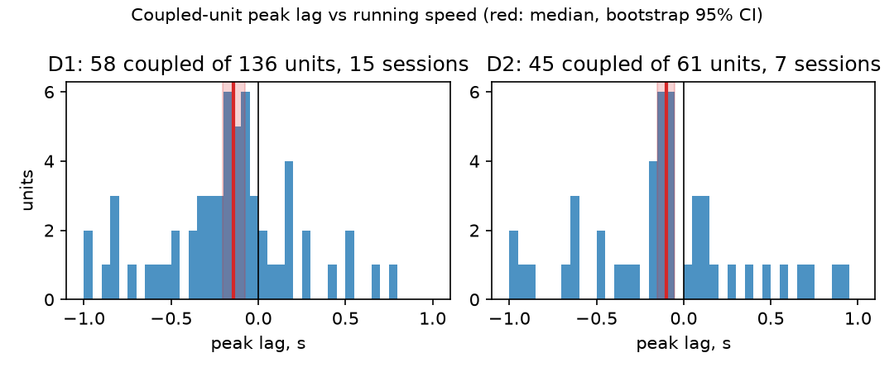
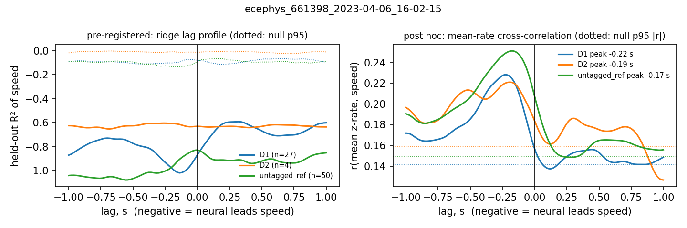

# Results

The full write-up of the four experiments, with the numbers quoted from the
committed `metrics.json` files. The README carries the short version.

Provenance: Experiment 1 outputs at commit `896f68c` (code unchanged since),
Experiment 2 at `dbc8ed8`, Experiment 3 analysis code at `6cfff70` (one mouse's
`metrics.json` records `5c913f0`, a summary/plotting-only commit). Each
`metrics.json` records its own SHA. The two post hoc checks below
(`scripts/posthoc_*.py`) were run against the 0.3.0 analysis code, which 0.3.1
does not change.

**Corrections, 2026-11-01.** Two post hoc checks, run after release 0.3.0 and
labelled as post hoc where they appear, change how two results should be read.
The pre-registered verdicts are unchanged and still scored as written; the
readings beneath them are corrected.

1. Experiment 3: the D1/D2 shared/private partition is the same as the
   partition of random two-way splits of the same neurons, in all six mice. The
   equal shared fractions describe these striatal neurons as a population; they
   say nothing about D1 versus D2. Version 0.3.0 called them "the robust
   finding" — withdrawn.
2. Experiment 4: the pre-registered bootstrap treats units as independent.
   Resampling mice, then sessions, then units gives 95% intervals that include
   zero for both D1 and D2. The 0.3.0 statement that tagged neurons lead by
   more than untagged ones is withdrawn: within the same sessions the difference
   has no consistent sign.

## Experiment 1 — shared / private factor analysis

Model: factor analysis on the concatenated vector `[x1, x2]` with a
block-sparse loading matrix, fit by EM with the zero pattern enforced at every
M-step.

```
x1 = W1 z + V1 u1 + mu1 + e1        z  : shared latents (d_shared)
x2 = W2 z + V2 u2 + mu2 + e2        u1 : private to population 1 (d_private)
                                    u2 : private to population 2 (d_private)
```

It is the static special case of probabilistic CCA with explicit private
subspaces (Bach & Jordan 2005) and of DLAG without time delays
(Gokcen et al. 2022). The experiment:

- selects `d_shared` and `d_private` by **held-out log-likelihood** under
  block-grouped cross-validation (contiguous time stays together),
- reports the **variance partition** (shared / private / noise) per population,
- benchmarks cross-population prediction (E[x2 | x1]) against
  **reduced-rank regression** at each rank (Semedo et al. 2019) and CCA,
- **decodes the behavior** from each subspace (shared, private-1, private-2,
  raw populations) with ridge regression under grouped CV, against a
  circular-shift null that preserves the behavior's autocorrelation.

On the synthetic demo (planted: 3 shared, 2 private per population, behavior a
readout of the shared factors plus population-1's private factors) the shared
subspace carries the behavior (R² ≈ 0.74), population-2's private subspace does
not (≈ 0), and the RRR curve flattens by rank 3. At the demo's firing rates the
linear-Gaussian model selects more dimensions than were planted (6 shared,
4 private) because Poisson counts put nonlinear structure into extra linear
directions; in the lower-gain regime the test suite uses, held-out likelihood
selects the planted 3 exactly. See Limits.



**Real session 715093703, VISrl (76 units) ↔ VISp (60 units).** Held-out
likelihood selects 6 shared and 4 private dimensions. Variance is mostly
noise at 50 ms (VISrl: 9% shared / 5% private / 86% noise; VISp: 16 / 10 /
75). The shared subspace decodes running speed (R² 0.27 ± 0.04 across folds;
circular-shift null p95 −0.11) and neither private subspace does (−0.04,
−0.07). All latents together reach 0.32 and the raw populations 0.41, so the
10-dimensional model keeps most, not all, of the behavior-relevant signal. The
raw populations split sharply: VISrl alone decodes running at 0.38, VISp alone
at 0.14. Cross-area prediction is near zero: E[VISp | VISrl] has R² −0.05
under the factor model and reduced-rank regression tops out at 0.04 by rank 6.
Read together: at this bin size the "shared" factors look like a slow signal
common to both areas (locomotion / arousal, strongest in RL), not fast
inter-area communication. That is the expected place for a static model to
land and the reason DLAG-style delays are the next comparison.



## Experiment 2 — connectivity-constrained linear dynamics

Per-area population latents are stacked into `S` and fit with a one-step
linear model `S[t+1] = S[t] A + b`. The atlas enters as a penalty on each
area-to-area block of `A` proportional to how *weak* that projection is:

```
penalty(A) = λ · Σ_{a,b} (1 − conn[a,b]) · ‖A_block(a,b)‖²
```

The test is held-out one-step prediction of the atlas-constrained model vs. an
unconstrained ridge model vs. models fit with a **shuffled** connectivity
matrix at the same λ. If the atlas carries information about the dynamics the
true-atlas curve should separate from the shuffled curve as λ grows; if it
doesn't, that's the finding. On the synthetic demo (six areas, eight latents
each, 1 200 bins, a planted sparse projection matrix) the two curves separate
at large λ and the fitted block norms correlate with the planted connectivity.



**Real session 715093703, five visual areas.** The unconstrained one-step
model explains R² 0.41 of the next bin's latents. The atlas prior does not
help: at every λ from 0.01 to 10 the atlas-constrained and shuffled-atlas
models agree to three decimals (Δ ≤ +0.001), and both lose accuracy once λ
exceeds about 1 (0.41 → 0.38 at λ = 10). So on this session the projection-density
matrix carries no information the one-step predictor can use beyond
what any equally sparse prior would. Nor does the unconstrained fit recover
the anatomy on its own: its off-diagonal coupling-block norms correlate with
projection density at r = 0.38 over 20 blocks, permutation p = 0.075 (null
95th percentile 0.42). 77% of ‖A‖² sits in the within-area blocks. On this
session, then, the answer to "does wiring constrain dynamics?" is no at 50 ms.



Two things the first real run taught, both now fixed in the code: the penalty
was in absolute units and was swamped by a 10× longer recording, so λ is now
dimensionless (see `models/coupling.py`; the synthetic curve is unchanged);
and the anatomy correlation was being computed from the atlas-penalised fit,
which inflated it to r = 0.54 (p = 0.016) even at the near-zero selected λ —
it is now computed from the λ = 0 fit.

## Experiment 3 — D1 vs D2 striatal neurons, shared / private covariance, and the lever

Pre-registered in [`docs/experiment3_preregistration.md`](https://raw.githubusercontent.com/JeremyGracey-AI/allen-circuit-dynamics/main/docs/experiment3_preregistration.md)
(commit `b1676da`) before any model was fit; the thresholds below are the ones
written there. Data: Klee et al. (2026), six mice, two-photon calcium imaging
of anterior dorsal striatum at 30 fps, every ROI labelled D1-SPN or D2-SPN, a
lever on a rotary encoder (displacement, encoder units), video motion energy,
cued and self-paced blocks. Same model as Experiment 1 with D1 as population 1
and D2 as population 2; 100 ms bins; D1 and D2 count-matched by ten random
subsample draws; everything reported as the mean over draws.

**Partition (the observation contract).** In every mouse the shared fraction
of variance is nearly the same for D1 and D2 — 0.18 / 0.18, 0.21 / 0.22,
0.25 / 0.25, 0.24 / 0.23, 0.26 / 0.21, 0.21 / 0.16 — and the population-specific
(private) fraction is 1–5%. Almost all the correlated variance in
either population is variance it shares with the other. Cross-prediction by
reduced-rank regression is symmetric (rank 8: D2 from D1 0.08–0.18, D1 from D2
0.10–0.18). Held-out likelihood selected the top of the pre-registered
`d_shared` grid (8) in four of six mice, so the shared dimensionality is a
floor, not an estimate; `d_private` reached the top of its grid (4) in the
same four.

**Post hoc control: random splits (added 2026-11-01, not pre-registered).** If
D1/D2 identity carried covariance of its own, the D1/D2 split would leave more
private variance than a random split of the same neurons into two groups of the
same size. Per mouse: the count-matched neurons of subsample draw 0, the
dimensions held-out likelihood selected above (mean over draws, rounded;
`d_private` at least 1), the same preprocessing and model, against 50 random
splits of the pooled neurons. Shared and private fractions are the mean of the
two groups.

| Mouse | Neurons per group | (d_shared, d_private) | Shared: D1/D2 · random | Private: D1/D2 · random (p95) | p |
|---|---|---|---|---|---|
| JK238 | 84 | (8, 4) | 0.182 · 0.184 | 0.025 · 0.024 (0.025) | 0.06 |
| JK239 | 53 | (8, 4) | 0.207 · 0.207 | 0.030 · 0.031 (0.034) | 0.78 |
| JK244 | 80 | (6, 2) | 0.243 · 0.243 | 0.022 · 0.020 (0.023) | 0.08 |
| JK323 | 98 | (8, 4) | 0.231 · 0.230 | 0.047 · 0.046 (0.051) | 0.25 |
| JK324 | 61 | (8, 4) | 0.227 · 0.227 | 0.049 · 0.049 (0.053) | 0.41 |
| JK326 | 21 | (4, 1) | 0.189 · 0.189 | 0.023 · 0.022 (0.026) | 0.33 |

p is the fraction of random splits with at least the D1/D2 private fraction
(add-one corrected, so the smallest possible value is 0.02). In no mouse is the
D1/D2 split different from a random one: shared fractions agree to within
0.002 and the private fraction sits inside the random-split distribution. The
D1/D2 private fraction is above the random-split mean in five of six mice, by
0.0004–0.0024 of the variance, and the per-mouse p values combine to 0.12
(Fisher) — a difference too small and too weak to call. So
the partition describes the population — any two halves of these neurons share
about the same fraction of their variance — and is silent on cell type. What
this control cannot say is whether the data could have detected a D1- or
D2-specific subspace of plausible size; that needs a power analysis with
planted type-specific covariance, which has not been run. Reproduce with
`scripts/posthoc_exp3_random_split.py` (about 4 minutes); output in
`outputs/force_klee/posthoc_random_split.json`.

**Decoding (the action contract).** The pre-registered verdicts, six mice:

| | Hypothesis | Verdict | What the numbers say |
|---|---|---|---|
| H1 | D1 and D2 decode the lever equally | supported, 5 / 6 | Substantive only in JK239 (0.15 vs 0.14); JK238 fails (0.38 vs 0.26); in three mice both are ≈ 0, so equality is trivial |
| H2a | shared subspace beats the shift null | supported, 5 / 6 | Real in JK238 (0.36, null p95 −0.27) and JK239 (0.17, −0.14); marginal in JK244 (0.05); ≈ 0 in the three EY217 mice, where it clears a negative null by 0.01–0.05 |
| H2b | shared beats private-D1 + private-D2 | supported, 4 / 6 | Private subspaces decode nothing anywhere (−0.01 to 0.03) |
| H3 | neural leads the lever by 0.1–0.7 s | **not supported**, 1 / 6 | The shared lag profile peaks at 0 in five mice; its right tail (neural after lever) decays slower, which is the indicator's own kernel |
| H4a | shared fraction same across contexts | not supported, 3 / 6 | Differences of 0.01–0.09 between cued and self-paced |
| H4b | lead differs across contexts | not supported, 3 / 6 | Context subsets have 4–6 CV blocks, so single-block test folds with their own lever offsets; the context analysis is under-powered as pre-registered |

Motion regression (video motion energy, ±200 ms, inside the training fold)
halves JK238's shared R² (0.36 → 0.18) and leaves JK239's (0.17 → 0.24) and
the near-zero mice unchanged, so in the one mouse with strong decoding about
half of the shared–lever relation is movement of the animal rather than the
lever as such.




**Reading** (corrected 2026-11-01). Under this model D1 and D2 are not
separable by covariance: their partition is what any random split of the same
neurons gives (post hoc control above). That fits Klee et al.'s finding that
both populations encode the action, but it is not evidence for it, because a
partition every random split reproduces cannot speak to cell types. Whether the
shared subspace carries the lever varies by animal
from 0.36 to nothing, and the three mice with no lever signal are the three
D1-Cre (EY217) animals; the neural–video correlation is also a third of the
others' there, so it is a property of those recordings (press rates are
half the others') rather than of the model. The
timing question is not answerable at 30 fps with a slow indicator: a lead
shorter than the GCaMP decay is folded into lag 0. Experiment 4 tests that on
spikes.

Per-mouse `metrics.json` and figures are under `outputs/force_klee/`;
`scripts/evaluate_prereg.py` reproduces the table from them. JK326's metrics
record `5c913f0`, a commit that changed only the summary and plotting code
after the analysis code at `6cfff70`.

## Experiment 4 — do D1 and D2 spikes lead the motor output?

Pre-registered in [`docs/experiment4_preregistration.md`](https://github.com/JeremyGracey-AI/allen-circuit-dynamics/blob/main/docs/experiment4_preregistration.md)
(commit `435c197`) before any code read the data. Experiment 3's H3 failed at
30 fps calcium, and its write-up blamed the indicator. This experiment tests
that excuse on spikes. Data: Lakunina et al. (2026), the Neuropixels Opto
sessions on the Allen Institute for Neural Dynamics open bucket, read as
NWB-zarr over HTTP. The paper's own optotagging verdict (`predicted_cell_type`)
labels each unit D1, D2, ChAT, … or untagged. Behaviour is running speed on a
disc, not a lever. Pre-stimulus epoch only (10–20 min per session, no laser),
10 ms bins, QC-passing striatal units.

Forty sessions listed; **31 analysed**. Five have no `brain_region` column in
their units table and four have no running wheel (face tracking only); both
are skipped with the reason logged. Tagged units in the analysed set: 136 D1
in 15 sessions, 61 D2 in 7 sessions. Both types with ≥ 3 units in the same
session: one session.

| | Hypothesis | Verdict | What the numbers say |
|---|---|---|---|
| H5a | Striatal spikes lead running (pooled) | **supported** | Coupled-unit median peak lag D1 **−145 ms** (bootstrap CI −205 to −75), D2 **−100 ms** (−150 to −50); both inside the pre-registered −500…−50 ms window, both CIs exclude 0 |
| H5b | …at the population level (ridge profile) | not supported | Negative and above null in 1 / 15 (D1) and 2 / 7 (D2) sessions. The ridge profile is broken by design here: mice run in a few CV blocks and sit in the rest, so cross-block R² is negative at every lag |
| H6 | D1 and D2 lead by the same amount | not supported | Median difference −45 ms, CI −165 to +40. The CI includes 0 but is wider than the ±100 ms the rule required: under-powered, not different |
| H7 | Both types are speed-coupled | **supported** | Coupled fraction D1 0.43 (58 / 136), D2 0.74 (45 / 61) |



**Post hoc: resample animals, not units (added 2026-11-01, not
pre-registered).** The H5a bootstrap is the pre-registered one, and it treats
the 58 D1 and 45 D2 coupled units as independent. They are not: units from one
session share a mouse, a probe and a running trace. Resampling mice, then
sessions within a mouse, then units within a session (4000 resamples; same
eligibility, ≥ 3 units of the type in the session) widens both intervals past
zero:

| | Mice | Sessions | Coupled units | Median peak lag | 95% CI, mouse → session → unit | Mice with a negative median |
|---|---|---|---|---|---|---|
| D1 | 7 | 12 | 58 | −145 ms | −360 to +70 ms | 5 of 7 |
| D2 | 5 | 7 | 45 | −100 ms | −260 to +60 ms | 4 of 5 |

Per-mouse medians: D1 −1000, −290, −165, −130, −80, +160, +260 ms; D2 −370,
−160, −50, −50, +60 ms. The direction is mostly negative; with this many
animals the size is not pinned down, and a claim about striatum, rather than
about these 103 units, does not clear zero. Reproduce with
`scripts/posthoc_exp4_hierarchical.py outputs/lead_aind`; output in
`outputs/lead_aind/posthoc_hierarchical.json`.

**Reference population.** Untagged striatal units also lead: 1367 of 2546
coupled, median peak lag −60 ms, 59% at negative lags (D1 72%, D2 64%).
Version 0.3.0 read this as the tagged projection neurons leading by more than
the unlabelled mix. That comparison pooled across sessions with different mice
and different running. Within the same session (same speed trace, same probe;
≥ 2 coupled tagged and ≥ 5 coupled untagged units), the median tagged-minus-untagged
difference is −38 ms for D1 (10 sessions, tagged earlier in 5) and −20 ms for
D2 (5 sessions, earlier in 3). No consistent difference; the 0.3.0 statement is
withdrawn.

**Post hoc, labelled as such.** A session-level measure added after the first
session showed the ridge profile cannot see timing: the mean z-rate of each
group cross-correlated with speed, same shift null. Negative peak and coupled
in 7 / 15 (D1) and 4 / 7 (D2) sessions. It does not enter any verdict.

**Heterogeneity.** About a third of coupled tagged units peak at positive lags
(after speed), and a few at the ±1 s window edge. The pooled median is the
pre-registered statistic; the distribution is in the figure and per unit in
each session's `metrics.json`.

**Exploratory, one session** (`661398_2023-04-06`, 27 D1 / 4 D2, 100 ms bins):
`d_shared = 2`, shared fractions D1 0.08 / D2 0.17. Four D2 units; not
compared with Experiment 3's partition.

**Reading** (corrected 2026-11-01). In these sessions, speed-coupled D1 and D2
units tend to fire before running speed changes: the pooled unit medians are
−145 and −100 ms, and most animals' medians are negative. Two things keep this
short of a claim about striatum. First, at the animal level both intervals
include zero (post hoc above). Second, the lag is measured against the wheel
speed as exported in the NWB file; any delay in how that signal was computed
(a causal filter, encoder latency) would make spikes look earlier than they
are, and it has not been checked against the raw encoder. If the lead holds, it
is shorter than GCaMP's decay, which would fit Experiment 3's lag-0 peak being
the indicator rather than the biology; different mice, a different lab, and
running rather than a lever press keep that a consistency check, not a
confirmation.



`scripts/evaluate_prereg_exp4.py outputs/lead_aind` rebuilds the table from the
per-session files. Every session was computed twice: once in the cloud (Linux,
numpy 2.4, scipy 1.17, scikit-learn 1.9) and once on a second machine — 22
sessions on WSL2 (numpy 1.23, scipy 1.10, scikit-learn 1.7) and 9 on macOS
arm64. The committed files are the second-machine copies. Against the cloud
run, all 55,298 recorded per-session fields agree to within 5 × 10⁻¹³, no peak
lag, coupling flag or count differs, and the pooled verdict file is identical.

## Limits, stated up front

- The shared/private model is linear-Gaussian and static. On Poisson-like
  counts it needs more dimensions than the generative truth to absorb the
  nonlinearity; held-out likelihood, not the planted number, is the criterion.
- Experiment 2's "areas" are PCA latents, not cell types, and the atlas prior
  is projection *density*, which says nothing about sign or cell-type
  specificity. The experiment can only say whether that coarse structure
  predicts coupling — not why.
- Running speed is a behavioral proxy available in the open dataset; it is not
  a measured motor output. The code accepts any continuous signal on the same
  bins.
- One session, one bin size, one stimulus epoch. Nothing above should be
  generalised until it holds across sessions and at 10–25 ms bins.
- The decoded behavior is running speed; a slow common signal that tracks it
  will show up as "shared" under a static model whether or not the areas
  communicate. Time-delayed shared latents (DLAG) are the test that separates
  the two.
- Experiment 3: one session per mouse (no learning across days), no EMG, lever
  displacement rather than force, calcium at 30 fps (no timing claim finer
  than the indicator), and three of six mice with little lever signal in the
  neural data at all. The context split is under-powered by block count.
- The `d_shared` grid ceiling (8) was hit in four mice; the shared
  dimensionality reported there is a lower bound. The `d_private` ceiling (4)
  was hit in the same four.
- Experiment 3's partition does not distinguish D1 from D2: random splits of
  the same neurons give the same shared and private fractions (post hoc
  control). How large a type-specific subspace it could detect has not been
  measured.
- Experiment 4: running, not a lever; head-fixed on a disc; pre-stimulus epochs
  of 10–20 min; tagged counts are small per session (most sessions tag one
  type), so the pooled per-unit statistic is the real test and the D1-vs-D2
  comparison is under-powered. Nine of forty sessions could not be analysed
  (missing region labels or no wheel). The paper's tagging verdict is used as
  published, not re-derived.
- Experiment 4's pre-registered bootstrap resamples units as if independent;
  resampled by mouse, the lead's intervals include zero (7 mice for D1, 5 for
  D2). Lags are relative to the exported wheel-speed signal, whose processing
  delay has not been verified.

## References

- Bach & Jordan (2005). A probabilistic interpretation of canonical correlation analysis.
- Semedo, Zandvakili, Machens, Yu & Kohn (2019). Cortical areas interact through a communication subspace. *Neuron*.
- Gokcen, Jasper, Semedo, Zandvakili, Kohn, Machens & Yu (2022). Disentangling the flow of signals between populations of neurons. *Nature Computational Science*.
- Siegle et al. (2021). Survey of spiking in the mouse visual system reveals functional hierarchy. *Nature*. (Visual Coding Neuropixels dataset)
- Oh et al. (2014). A mesoscale connectome of the mouse brain. *Nature*. (Mouse Connectivity Atlas)
- Klee, Fernando-Peiris, Athalye, Costa, Peterka & Sippy (2026). Shared striatal neurons exhibit context-specific dynamics for internally and externally driven actions. *Science Advances*. Data: Zenodo 10.5281/zenodo.16333867, CC BY 4.0. (Experiment 3 dataset)
- Athalye, Ganguly, Costa & Carmena (2017). Emergence of coordinated neural dynamics underlies neuroprosthetic learning and skillful control. *Neuron*. (shared vs. private variance vocabulary)
- Lakunina, Socha, Ladd, …, Siegle & Carandini (2026). Neuropixels Opto: combining high-resolution electrophysiology and optogenetics. *Nature Methods*. Data: Allen Institute for Neural Dynamics, `s3://aind-open-data`, CC BY 4.0; Code Ocean capsule 1593868. (Experiment 4 dataset)
